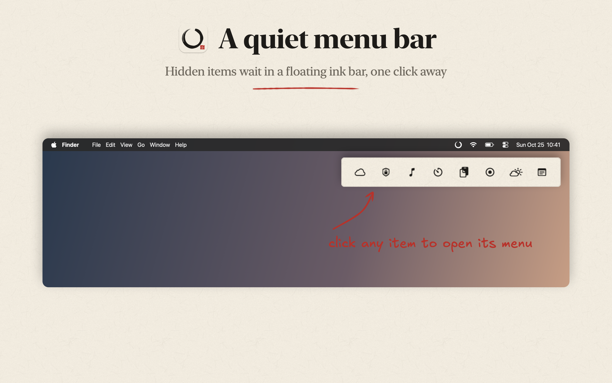
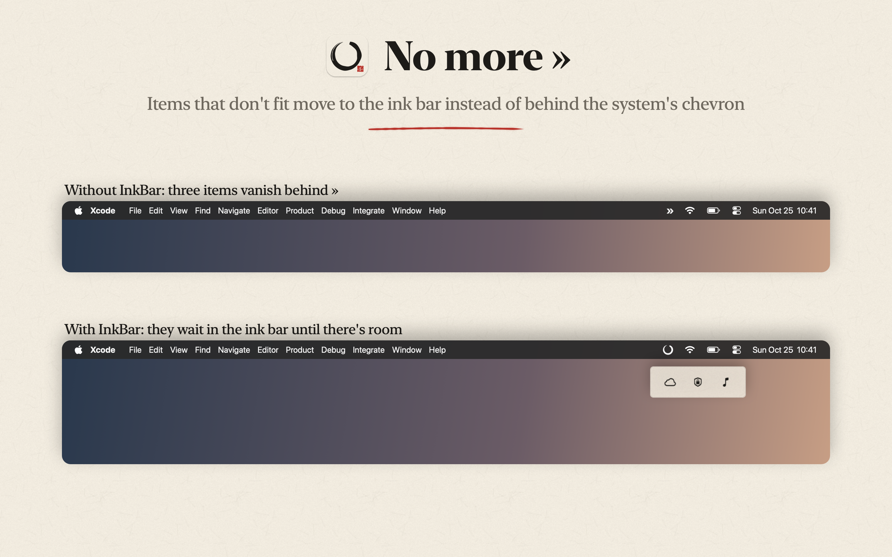
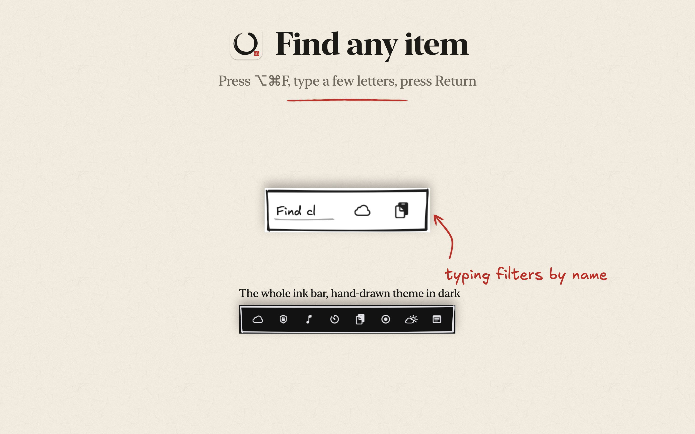
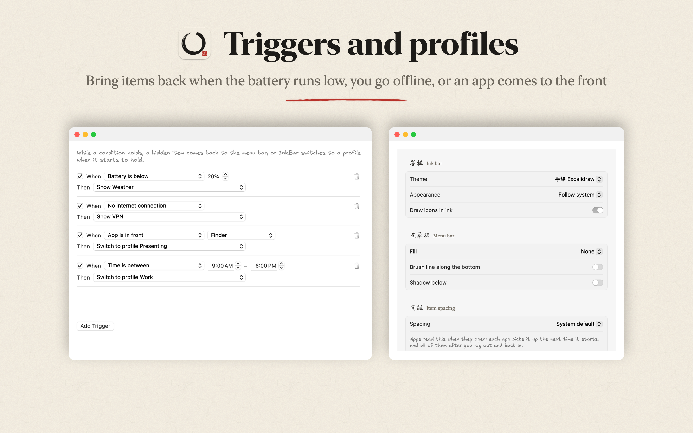

# InkBar 墨栏

A menu bar organizer for macOS 27, drawn in ink. Hidden items wait in a floating ink bar
under the menu bar instead of crowding it, and items that don't fit go there too, so the
system's » overflow button never has to appear.

Two themes, shared with [InkStats](../inkstats): 水墨 ink-wash and 手绘 Excalidraw.

## Screenshots

<p>
<a href="docs/screenshots/1-ink-bar.png"></a>
<a href="docs/screenshots/2-overflow.png"></a>
</p>
<p>
<a href="docs/screenshots/3-search.png"></a>
<a href="docs/screenshots/4-triggers.png"></a>
</p>

## Install

```sh
brew install --cask amoswzw/tap/inkbar
```

Or download the zip from [Releases](https://github.com/amoswzw/InkBar/releases), unzip it, and move
InkBar.app to Applications. Releases are signed with Developer ID and notarized by Apple.

## Using it

| | |
|---|---|
| Click the ensō, or press ⌥⌘B | Open the ink bar. Hold ⌥ to include always-hidden items. |
| ⌥⌘F | Search: type to filter, ↩ opens the first match, ⎋ closes. |
| Click an item in the ink bar | It returns to its place in the menu bar, opens its menu, and hides again when the menu closes. |
| Right-click the ensō | Show everything, switch profile, settings. |

Settings:

- **Items**: put each app or system item in *Shown*, *Hidden* or *Always hidden*.
- **Layout**: reorder the menu bar.
- **Triggers**: bring a hidden item back, or switch profile, when the battery is low, on battery power, offline, on a named Wi-Fi network, when an app is open or in front, or during a time of day.
- **Profiles**: save and switch sets of sections.
- **Appearance**: ink bar theme; menu bar tint, paper, brush line and shadow; item spacing.
- **General**: hover to open, automatic overflow, shortcuts, open at login.

## How it works

macOS 27 draws every status item inside the MenuBarAgent process, so the old trick of a very
wide separator item no longer pushes anything off screen. InkBar uses three system mechanisms:

- **Hiding** uses the menu bar allowlist that macOS keeps for assessment (exam) mode
  (`MBAssessmentModeAssertion` in the private MenuBarClientCore framework). Items of apps
  missing from the list aren't drawn. The system drops the list when InkBar quits or crashes,
  so nothing stays hidden by accident.
- **Reading** the menu bar goes through Accessibility: each app's extras menu bar lists its
  status items and their frames.
- **Moving** an item is a ⌘-drag posted as mouse events, the same gesture you'd make by hand.

What this means in practice:

- Third-party apps hide and show as a whole; the nine system items (clock, Wi-Fi, battery,
  Bluetooth, sound, displays, keyboard, screen mirroring, Control Center) hide one by one.
- While anything is hidden, macOS also stops drawing apps that aren't notarized, whatever the
  list says. InkBar marks them with a red dot, keeps them in the ink bar, and still opens them
  from there. Unless InkBar itself is notarized, its own ensō is hidden too; use ⌥⌘B.
- Hidden items can't be photographed, so InkBar captures each item while it's visible
  (Screen Recording) and keeps the pictures in `~/Library/Application Support/InkBar/Icons`.
- Item spacing is an AppKit setting read when an app starts: each app picks it up when it
  next opens, and all of them after logging out and back in.
- Menu bar styling is a click-through layer over the bar, since the bar's own background
  is opaque on many setups; strong fills dim the items under them.

## Permissions

- **Accessibility**: read the menu bar, press items, drag them.
- **Screen Recording**: capture item pictures. Only the menu bar is captured.
- **Location**: asked only for a Wi-Fi network-name trigger, since macOS treats network names as location.

Nothing leaves the Mac.

## Build

```sh
./scripts/build-app.sh      # build/InkBar.app, signed with your Developer ID if one is in the keychain
swift test
```

Development flags: `--scan` prints what InkBar sees in the menu bar; `--render-icon <png>` and
`--render-settings <dir>` render the icon and settings tabs to images; `--render-screenshots <dir>`
draws the README screenshots from demo items.

## Layout

```
Sources/CMenuBar/          the allowlist wrapper (Objective-C, loads MenuBarClientCore at runtime)
Sources/InkBar/Core/       scanning, hiding, overflow, activation, moving, triggers, icons, hotkeys
Sources/InkBar/UI/         ink bar, settings, menu bar styling
Sources/InkBar/Render/     ink-wash and sketch drawing, shared with InkStats; the app icon
```

MIT License.
